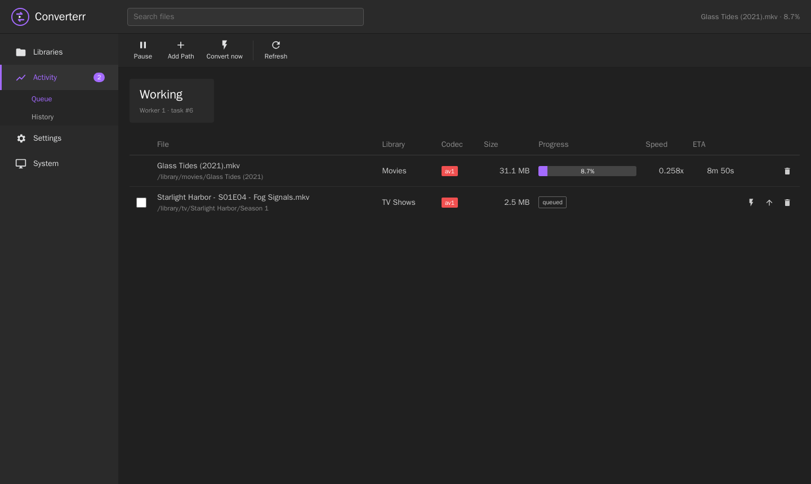
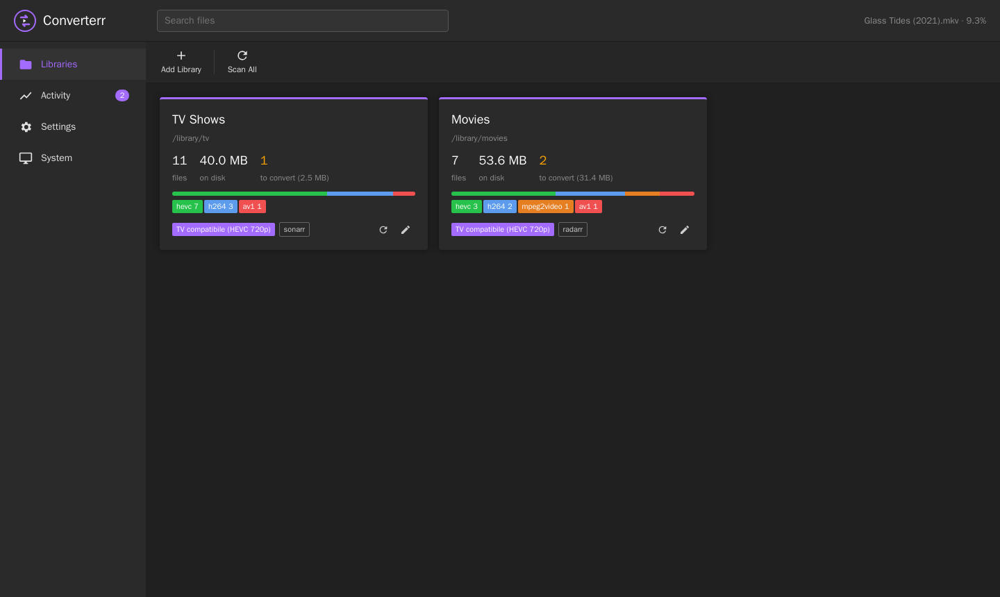
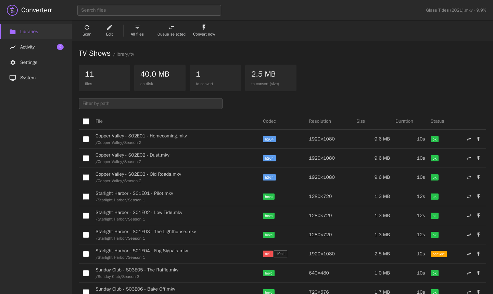
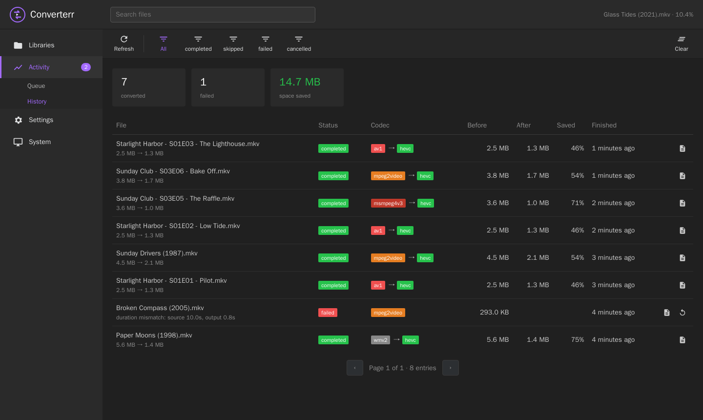
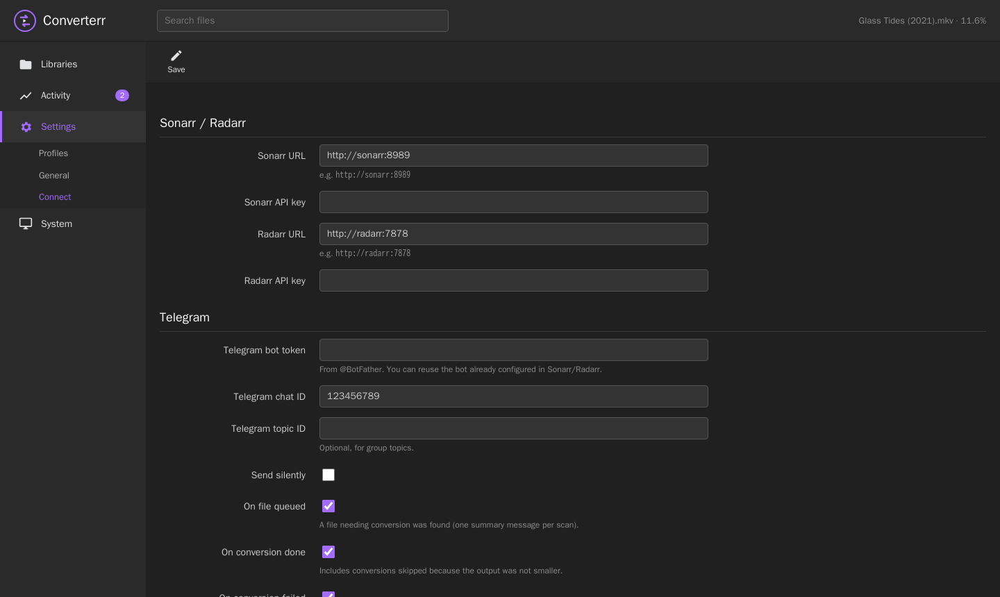

# Converterr

[](https://github.com/teopost/converterr/actions/workflows/ci.yml)
[](LICENSE)

Automatic media library transcoder with a Sonarr/Radarr-style web UI.
**Website and documentation: https://teopost.github.io/converterr/**



Converterr watches your movie and TV libraries, finds the files your players can't
play directly (AV1 on an older TV, VC-1, MPEG-2, DivX…) and converts them in place
with ffmpeg. Afterwards it tells Sonarr or Radarr to rescan. It is a single small Rust
binary with an embedded web UI. Everything is open source: no accounts, no
"supporter" tiers, and no limits on libraries or workers.

Inspired by [Unmanic](https://github.com/Unmanic/unmanic), but written from scratch.

## Features

- **Libraries**: folders to scan, each with a profile, an extension filter and an
  optional Sonarr/Radarr link.
- **Profiles**: *which* files to convert (a list of source codecs and/or "larger
  than W×H") and *how* (libx265 / libx264 / SVT-AV1, preset, CRF, max resolution,
  8/10-bit, container, audio).
- **Fast scans**: probe results are cached by size and mtime, so a rescan only
  probes new or changed files.
- **Safe replace**: ffmpeg writes to a cache folder. The output is checked with
  ffprobe (it must be readable and match the source duration) and only then
  replaces the original with an atomic rename. Optionally the original is kept
  when the output isn't smaller.
- **Time window and pause**: outside the window, running encodes are *suspended*
  (SIGSTOP), not killed, so a 6-hour encode can span several nights.
- **Convert now**: select one or more files (in a library or in the queue) and
  start them right away. They run on a dedicated worker and ignore the window
  and the queue order.
- **Telegram notifications**, formatted like Sonarr/Radarr's: files queued (one
  summary per scan), conversion done (with the space saved), conversion failed.
- **Sonarr/Radarr**:
  - a webhook converts files right after import;
  - after a conversion, Converterr triggers `RescanSeries` / `RescanMovie`;
  - paths are mapped per library.
- **HDR → SDR tone mapping** when an HDR source is encoded to 8-bit.
- **Activity**: queue with live progress, speed and ETA, history with space
  saved, the ffmpeg log of each task, and a log viewer.
- **API**: REST under `/api/v1`, authenticated with an `X-Api-Key` header, like
  the *arr apps.

## Screenshots

| Libraries | Library files |
|---|---|
|  |  |
| **History** | **Settings → Connect** |
|  |  |

## Quick start (Docker)

Pre-built multi-arch images (amd64, arm64) are published to GHCR:

```bash
docker pull ghcr.io/teopost/converterr:latest
```

To build the image yourself:

```bash
docker build -t converterr .
docker compose -f docker-compose.example.yml up -d
```

Open `http://<host>:8787`, then:

1. **Settings → Profiles**: check the default profile. It converts
   AV1/VC-1/WMV/MPEG-2/DivX3 to HEVC 720p 8-bit, CRF 26.
2. **Libraries → Add Library**: pick `/library/tv`, choose the profile and set
   *Notify* to Sonarr.
3. Click **Scan**. Files that need converting appear in **Activity → Queue**.

The image is built on Debian trixie. Debian's ffmpeg comes with an x265 that has
NEON assembly on arm64. On a Raspberry Pi 4 it encodes about 3.5× faster than
the "noasm" x265 found in some other images: 0.21× vs 0.06× realtime, for 1080p
AV1 → 720p HEVC veryfast.

### Sonarr / Radarr webhook

In Sonarr/Radarr go to *Settings → Connect → Webhook*, enable *On Import* / *On
Upgrade* and use this URL:

```
http://converterr:8787/api/v1/webhook?apikey=<your api key>
```

If Sonarr sees the library as `/tv` while Converterr sees it as `/library/tv`,
set the library's **Sonarr/Radarr path** to `/tv`.

## Configuration

| Variable          | Default   | Meaning                            |
|-------------------|-----------|------------------------------------|
| `CONVERTERR_DATA` | `/config` | Folder holding `converterr.db`     |
| `CONVERTERR_PORT` | `8787`    | HTTP port                          |
| `CONVERTERR_BIND` | `0.0.0.0` | Bind address                       |
| `RUST_LOG`        | `info`    | Log level                          |

All other settings live in the web UI: workers, time window, scan interval,
cache folder, API key, Sonarr/Radarr and the UI login (Settings → General →
Security: none, Basic or Forms with a login page like Sonarr, optionally not
required for local addresses).

## Building without Docker

You need Rust (stable) plus `ffmpeg` and `ffprobe` in `PATH`.

```bash
cargo build --release
CONVERTERR_DATA=./data ./target/release/converterr
```

## API

| Method | Path | |
|---|---|---|
| GET | `/api/v1/system/status` | version, ffmpeg, stats |
| GET/PUT | `/api/v1/settings` | |
| GET/POST, PUT/DELETE | `/api/v1/profile`, `/api/v1/profile/{id}` | |
| GET/POST, PUT/DELETE | `/api/v1/library`, `/api/v1/library/{id}` | |
| POST | `/api/v1/library/scan`, `/api/v1/library/{id}/scan` | start a scan |
| GET | `/api/v1/library/{id}/files?toConvert=true&search=&page=` | probed files |
| GET/POST | `/api/v1/queue` | list / queue `{"paths": ["..."], "force": false}` (files or folders) |
| POST | `/api/v1/queue/force` | `{"ids": [..]}`: convert queued tasks now |
| DELETE | `/api/v1/queue/{id}` | cancel / remove |
| POST | `/api/v1/queue/{id}/top` | move to the top |
| GET/DELETE | `/api/v1/history?status=&page=` | |
| POST | `/api/v1/history/{id}/retry` | |
| GET | `/api/v1/task/{id}/log` | ffmpeg command and output |
| GET | `/api/v1/workers`, POST `/api/v1/workers/pause` / `resume` | |
| POST | `/api/v1/webhook` | Sonarr/Radarr webhook |
| POST | `/api/v1/test/arr`, `/api/v1/test/telegram` | connection tests |

Full documentation: https://teopost.github.io/converterr/

## License

GPL-3.0-or-later. See [LICENSE](LICENSE).
